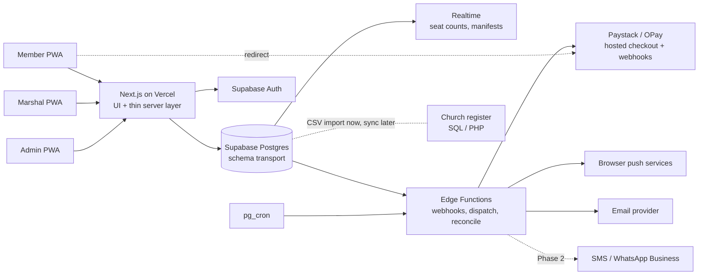

# System Architecture

**Status:** Proposed · **Version:** 0.1 · **Date:** 2026-10-12 · **Owner:** Backend/Systems Engineer
**Decisions:** D-001, D-003, D-004, D-005, D-006, D-008, D-009, D-010, D-013, D-014, D-023, D-024, D-025 · **Open issues:** OI-001, OI-029, OI-030, OI-032, OI-033

---

## 1. Context

Three role apps (Member, Marshal, Admin) are installed to the phone home screen as one PWA codebase. Members pay on a provider-hosted page. Notifications leave through Web Push, email, and later SMS. The church's existing SQL and PHP systems are a separate boundary (integration point undecided; see section 7).

## 2. Containers

| Container | Runs on | Responsibility | Holds secrets? |
|---|---|---|---|
| Web app (UI and server rendering) | Vercel Pro, function region `cpt1` (Cape Town) | Screens, forms, server components, PWA shell and manifest | Public keys only |
| Postgres `transport` schema | Supabase, region per OI-032 | Entities, state transitions, capacity ledger, audit, RLS | Database credentials (managed) |
| Auth | Supabase Auth | Sign-in, sessions, identity | Auth config |
| Realtime | Supabase | Pushes seat-count and manifest changes to open screens | None |
| Edge Functions | Supabase (Deno) | Provider webhooks, outbox dispatch, reconciliation, hold expiry trigger | Provider keys (function secrets only) |
| pg_cron | Supabase | Schedules: hold expiry, outbox dispatch, reconciliation, booking-window open and close | None |
| Storage | Supabase | Not used at MVP (cash receipt photos deferred with OI-023) | n/a |

## 3. Domains and ownership

Each domain owns its tables and the functions that change them. Other domains read through views or call the owner's function. They never write its tables directly.

| Domain | Owns | Public functions (examples) |
|---|---|---|
| Identity and membership | `profiles`, `membership_applications`, `user_roles`, `guests`, `guest_invites` | `submit_application`, `decide_application`, `invite_guest`, `redeem_invite` |
| Programmes and capacity | `programmes`, `routes`, `pickup_points`, `buses`, `route_bus_assignments`, `departures`, `seat_ledger` | `create_programme`, `publish_programme`, `set_bus_booking`, `open_booking` |
| Booking and manifest | `bookings`, `booking_riders`, `manifest_entries`, `booking_transitions` | `hold_seats`, `record_contact`, `confirm_free_booking`, `cancel_booking`, `board_rider`, `mark_no_show`, `add_walk_on` |
| Payments | `payments`, `payment_events`, `refunds` | `start_payment` (Edge Function), `apply_payment_event`, `request_refund`, `decide_refund` |
| Notifications | `notifications_outbox`, `push_subscriptions`, `notification_inbox` | `enqueue_notification` (internal), dispatch (Edge Function) |
| Support and incidents | `support_reports`, `report_messages`, `incidents` | `create_support_report`, `transition_support_report`, `open_incident`, `transition_incident` |
| Audit | `audit_events` (append-only), correction records | `record_correction` (internal, called by every owner) |

## 4. Data flows

**Booking with a free programme (D-051):** Member taps confirm → `hold_seats` locks the bus-leg row, checks the seat ledger, writes booking `held`, rider rows and ledger `+n` → the marshal calls the member and records the result with `record_contact` → on a reached call with the member's confirmation, `confirm_free_booking` writes `confirmed` and a transition row → Realtime pushes new seat count to all open screens → outbox row enqueued for the member and the marshal. An unreached free booking expires at 18:00 Lagos time the day before departure (D-055).

**Paid booking:** `hold_seats` as above → `start_payment` (Edge Function) creates a provider order with the booking reference and amount, returns the hosted checkout URL → member is redirected → provider calls the webhook → `apply_payment_event` verifies the signature, records the event once (idempotent on provider event ID), and confirms the booking if the amount and reference match → if the hold has already expired, the payment is routed to `reconciliation_required`, not silently dropped (PRD §6 item 2).

**Hold expiry:** pg_cron calls the expiry function every minute → held bookings past `hold_expires_at` become `expired` and release seats in the same transaction.

**Notifications:** every state change that needs a message writes an outbox row in the same transaction as the state change → dispatcher sends → failures retry with backoff and then move to a dead-letter state visible to admin.

**Support:** member submits → `support_reports` row with category → owner queue → every status change is an event with actor and reason.

## 5. Principles applied

These come from the team constitution (`CANONICAL-PROJECT-LIFECYCLE.yaml`, invariants) and the philosophy review (`RISK-ASSESSMENT.md`).

1. **UUID keys, versioned, never hard-deleted.** Deactivation is a state. Deletion is a correction record.
2. **Explicit state machines.** Named states and legal transitions only. Illegal transitions are rejected by the database, not only by the UI.
3. **Validated input only.** Every write goes through a function that validates. Tables are not writable by clients.
4. **Attributable actions.** Every transition stores actor, role, timestamp, prior state, new state and reason.
5. **Failures are objects.** Failed payments, failed notifications and rejected webhooks are rows with retry state, not log lines.
6. **Reversible by default.** Schema `transport`, feature flags as data (booking open per bus), no hard-coded programme names.
7. **One rule, one place.** Cancellation is one function callable by member, marshal and admin (PRD §6 item 3).

## 6. Non-goals (ponytail fence)

No microservices. No message broker (Postgres outbox is enough at this scale). No Kafka, Redis or separate search service. No knowledge graph, simulation or forecasting engine (D-022 gates forecasting on six months of data). No native store apps (D-009). No multi-tenant routing (OI-008 only namespaces).

## 7. Integration with the church's existing systems

The church runs SQL (database) with PHP (backend and frontend). This app does not use that stack (D-024). The meeting minutes raise two integrations: reading the member register, and the ask to connect to the existing SQL database.

**Recommended boundary (Recommendation, OI-015 and OI-038 apply):** CSV import of the membership register into `membership_roster` at MVP, run by admin, with every import recorded and reversible. A scheduled read-only sync is a Phase 2 option only after the register owner is named. The app never writes to the church's SQL system.

## 8. Quality attributes

| Attribute | Target | Mechanism |
|---|---|---|
| Correctness under concurrency | No overbooking under concurrent holds | Row lock on the bus-leg row; ledger; pgTAP and k6 tests (`TESTING/`) |
| Money safety | No payment confirmed without a server-verified provider event | Signature check, idempotency, amount and reference match |
| Availability on travel day | Marshal manifest reachable with poor signal | Offline printable manifest (R-007); last-synced timestamp shown |
| Security | Least privilege; no client-side authority | RLS; service keys server-only; MFA for admins (OI-039) |
| Cost | Within sponsor-approved budget | Vendor tier choices in OI-030; egress budget in `OPTIMISATION/` |
