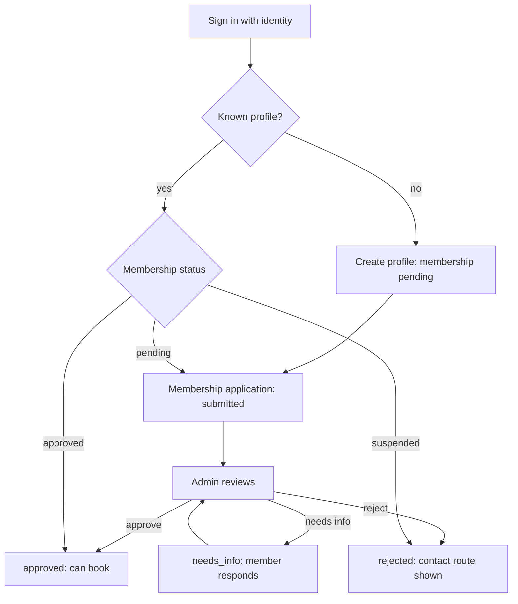

# Authentication and Membership Design

**Status:** Proposed · **Version:** 0.1 · **Date:** 2026-10-12 · **Owner:** Security & Compliance Lead
**Decisions:** D-007 (blocked), D-023, D-024 · **Open issues:** OI-001, OI-015, OI-028, OI-038, OI-039 · **Questions:** Q-004 (answered, D-029)

---

## 1. Two facts, kept apart

| Fact | Question it answers | Stored in | Set by |
|---|---|---|---|
| Identity | "Is this phone or Google account the same person across visits?" | Supabase Auth (`auth.users`) | Sign-in |
| Membership | "Does the church recognise this person as a member?" | `profiles.membership_status` and `membership_applications` | Admin approval function (and roster matching, once D-007 is decided) |

Being signed in gives no membership. Being approved gives membership. Every screen that matters checks membership, not just the session.

---

## 2. Sign-in methods (decided under Q-004, D-029)

| Who | Method | Second factor | Notes |
|---|---|---|---|
| Member | Phone OTP (one-time code by SMS) | None at MVP | SMS channel decided (D-028); vendor and cost open (OI-031). Password next to the phone code (D-056). Magic link (email) and Google are added later (D-052) |
| Member (optional) | Google | None | Identity only; does not grant membership. Button shown in the UI now; integrated at deployment (D-029) |
| Guest (invite link) | Phone OTP after clicking the link | None | Link grants a route to register, not access to bookings |
| Marshal | Phone OTP | Admin-enrolled device check (to decide, OI-039) | Few accounts; admin provisions |
| Admin | Email and password, or magic link | TOTP authenticator (required) | Stronger protection for refunds and corrections |

Supabase Auth supports Google OAuth, phone OTP through an SMS provider, email, and TOTP multi-factor. Verify current configuration steps and provider list at build. The Google button must follow Google's sign-in branding guidelines for its label and logo. A bare "Google" label may not comply; check at integration (Verify).

---

## 3. Membership gate

**Rules**

- First-time members are never approved automatically (dept session 2026-10-09).
- A first-timer registration is decided within 24 hours. The admin is reminded at 12 hours if it is still pending (Q-021, D-044).
- Approval records who approved, when, and a reason on rejection (audit).
- A rejected member can re-apply only through admin-visible channels; the record of the first decision is kept.

---

## 4. Duplicate and roster matching (D-007 and AUTH-2, blocked)

Options under the blocked policy:

| Option | Behaviour | Status |
|---|---|---|
| Block outright | Second signup with same identity is rejected | Not recommended: legitimate people with two numbers are locked out |
| Auto-merge on identity or roster match | Merge profiles when email, Google ID, or name and phone match a roster row | Risky: silent merges break the audit trail |
| Flag for admin review | Matches create a review item; admin decides | **Recommended** pending the reconvene |

The roster (`membership_roster`) is a matching aid, imported by CSV, not a source of truth (OI-015). A match never grants membership by itself at MVP; admin approval still applies.

---

## 5. Guests

- **Invite link (G2):** admin or member creates a link. The token is random, shown once, stored as a hash, expires, and has a use limit. Redeeming it creates a guest record linked to the host, status approved per the meeting decision.
- **Public (G1):** a guest form creates `pending_approval`; admin approves.
- Guests who need to book sign in with phone OTP. A guest without sign-in cannot book.

Token brute force is blocked by length (at least 128 bits of randomness), rate limiting on redemption, and expiry.

---

## 6. Roles and authorization

Roles: `member`, `marshal`, `admin`. A profile may hold several rows in `user_roles`; the active role is chosen per session in the app, but authorization checks the database each call.

| Action | member | marshal | admin |
|---|---|---|---|
| Book for self and approved guests | yes | walk-on only, own assignment | yes |
| Cancel own booking | in window | own assignment | yes |
| Board, no-show, remove riders | no | own assignment | yes |
| Create programmes and special events | no | no | yes |
| Assign marshals and buses | no | no | yes |
| Approve registrations, guests, refunds | no | no | yes |
| Correct records | no | no | yes (reason required) |
| See passenger contact details | own only | own assignment's riders only (PRD route scoping) | yes |
| Read audit | no | no | yes |

Enforced in Postgres (RLS and function checks). The client's menu hiding is a convenience, not a control.

**Claims.** Supabase can add custom claims to the access token through an auth hook that reads `user_roles`. Verify the current hook mechanism at build. The hook must read the table server-side. `user_metadata` is editable by users and must never be used for roles.

---

## 7. Sessions and devices

- Member sessions: long-lived refresh within the app, with sign-out on all devices available to the member.
- Marshal sessions: shorter; the duty screen requires an active session and re-checks membership on each load.
- Admin sessions: short idle timeout; MFA step on sign-in.
- Installed PWA and browser share the session cookie domain.

---

## 8. Recovery and changes

- Changed phone number: member requests; admin verifies identity against the roster or in person; change is audited.
- Lost admin MFA: second admin resets (OI-014 requires at least two trained admins).
- Marshal replaced: admin revokes the old role row and grants a new one (D-005).

---

## 9. Rate limits and abuse

- OTP requests: per phone and per IP; cooldown visible to the user.
- Application submissions: per device and per phone.
- Redemption of invite links: per token and per IP.
- Failed admin sign-ins: lockout with admin notification.

Values to be set by Security; the constitution calls for generous defaults and tuning later (RATE-1 to RATE-3).

---

## 10. Personal data in auth

- Phone numbers in E.164 format, used for sign-in, notifications and contact.
- No identity documents are collected.
- Retention of profile data is covered by OI-038.
