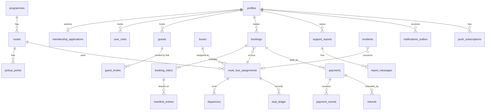

# Data Model: Entities

**Status:** Proposed · **Version:** 0.1 · **Date:** 2026-10-12 · **Owner:** Database/Data Architect
**Decisions:** D-001, D-005, D-008, D-013, D-023, D-025 · **Open issues:** OI-003, OI-008, OI-012, OI-015, OI-038

This is a logical model. Column names are proposed. Types assume Postgres. Nothing here is migrated yet.

---

## 1. Entity map

---

## 2. Tables

Mutability: **A** append-only · **S** state-machine (changed by a named function, each change writes a transition row) · **R** reference (admin-edited, each edit audited).

### 2.1 Identity and membership

| Table | Key | Key columns | Owner | Mut. | Notes |
|---|---|---|---|---|---|
| `profiles` | `id` = `auth.users.id` | full_name, phone_e164, email, membership_status (`pending`, `approved`, `rejected`, `needs_info`, `suspended`, `retired`), register_ref, joined_via (`first_timer`, `guest_conversion`, `register_import`) | Identity | S | Membership status changes only through approval functions |
| `membership_applications` | uuid | profile_id, status (`submitted`, `pending_review`, `needs_info`, `approved`, `rejected`), submitted_at, decided_by, decided_at, reason, referred_by_name | Identity | S | First-timer registration (AUTH-2 open) |
| `membership_roster` | uuid | import_batch_id, name, phone_e164, register_ref, row_hash | Identity | A | CSV import rows for matching (D-007 policy open). Not the source of truth for membership; a reference for matching |
| `roster_import_batches` | uuid | source_filename, imported_by, imported_at, row_count, checksum | Identity | A | Every import recorded |
| `user_roles` | uuid | profile_id, role (`member`, `marshal`, `admin`), granted_by, granted_at, revoked_at | Identity | A | Roles are rows, not user-editable metadata. Revoking writes a new row |
| `guests` | uuid | host_profile_id, profile_id (nullable), name, phone, origin (`public`, `invite_link`, `host_onboarded`), status (`invited`, `registered`, `pending_approval`, `approved`, `declined`, `removed`) | Identity | S | G1 to G3 in PROGRAMMES-LEGS-GUESTS §4 |
| `guest_invites` | uuid | host_profile_id, token_hash, expires_at, uses_remaining, created_at, revoked_at | Identity | S | Only a hash of the token is stored |

### 2.2 Programmes, routes, buses, capacity

| Table | Key | Key columns | Owner | Mut. | Notes |
|---|---|---|---|---|---|
| `programmes` | uuid | kind (`recurring`, `special_event`), name, starts_at, booking_opens_at, booking_closes_at, status (see STATE-MACHINES §5), price_minor, currency, refund_rule_ref, created_by | Programmes | S | Special events are rows with kind = `special_event` |
| `routes` | uuid | programme_id, name, active | Programmes | R | Route capacity = sum of its assigned buses (D-001) |
| `pickup_points` | uuid | route_id, name, sequence, active | Programmes | R | |
| `buses` | uuid | label, plate (optional), seats_total, active | Programmes | R | Plate is optional; do not store driver personal data |
| `route_bus_assignments` | uuid | programme_id, route_id, bus_id, marshal_profile_id, seats_capacity, booking_open (bool), status (`scheduled`, `booking_open`, `booking_closed`, `departed`, `closed`, `cancelled`) | Programmes | S | D-013 flag lives here. Row-locked for seat changes |
| `departures` | uuid | assignment_id, leg (`outbound`, `return`), departs_at, status | Programmes | S | Times per leg |
| `seat_ledger` | uuid | assignment_id, leg, delta (+/-), reason (`hold`, `confirm`, `release`, `expire`, `cancel`, `correction`), booking_rider_id, created_at | Booking | A | Available seats = capacity minus sum of active holds and confirmations, read in the same transaction as the lock |

### 2.3 Bookings and manifest

| Table | Key | Key columns | Owner | Mut. | Notes |
|---|---|---|---|---|---|
| `bookings` | uuid | reference (human, unique), programme_id, assignment_id, leg (`outbound`, `return`, `round_trip`), booked_by_profile_id, status (`held`, `confirmed`, `cancel_pending`, `cancelled`, `expired`), hold_expires_at, source (`member`, `marshal_walk_on`, `admin`), version | Booking | S | D-025 axis 1 only |
| `booking_transitions` | uuid | booking_id, from_status, to_status, actor_profile_id, actor_role, reason, correlation_id, at | Booking | A | Every booking change writes here |
| `booking_riders` | uuid | booking_id, rider_type (`member`, `guest`, `walk_on`), profile_id (nullable), guest_id (nullable), display_name, host_profile_id (for guests), leg, status (`active`, `removed`) | Booking | S | A rider on a round trip has two manifest entries |
| `manifest_entries` | uuid | booking_rider_id, assignment_id, leg, board_status (`awaiting`, `boarded`, `no_show`, `removed`), marked_by, marked_at, reason | Manifest | S | D-025 axis 3. Changes write a row here and in `manifest_transitions` |
| `manifest_transitions` | uuid | manifest_entry_id, from_status, to_status, actor_profile_id, actor_role, reason, at | Manifest | A | Attribution for every board, no-show, removal |
| `waitlist_entries` | uuid | programme_id, assignment_id (nullable until a bus is set), leg, profile_id (nullable), guest_id (nullable), rider_type, priority_rank, status (`waiting`, `offered`, `accepted`, `declined`, `expired`, `withdrawn`), offered_at, offer_expires_at, booking_id (nullable), created_at | Booking | S | D-030. Priority: first-timer guests first, then join time (D-034). Every change writes a waitlist transition row |

### 2.4 Payments and refunds

| Table | Key | Key columns | Owner | Mut. | Notes |
|---|---|---|---|---|---|
| `payments` | uuid | booking_id, provider (`paystack`, `opay`), provider_reference (unique per provider), amount_minor, currency, status (see STATE-MACHINES §3), redirected_at, confirmed_at, failed_reason | Payments | S | No card, account or wallet fields. Ever |
| `payment_events` | uuid | provider, provider_event_id (unique with provider), event_type, payload_hash, payload_json_redacted, received_at, processed_at, outcome | Payments | A | Redacted payloads only. Duplicate event IDs are rejected at insert |
| `refunds` | uuid | payment_id, amount_minor, status (`requested`, `approved`, `denied`, `processing`, `completed`, `failed`), requested_by, decided_by, provider_refund_reference, reason | Payments | S | Policy values from OI-036 |
| `idempotency_keys` | (caller, key) | response_hash, created_at, expires_at | Platform | A | Deduplicates retried mutations (ADR-0002) |

### 2.5 Support and incidents

| Table | Key | Key columns | Owner | Mut. | Notes |
|---|---|---|---|---|---|
| `support_reports` | uuid | reference (human), reporter_profile_id, category (`booking_problem`, `payment_problem`, `app_bug`, `travel_incident`, `other`), booking_id (nullable), programme_id (nullable), description, status (see STATE-MACHINES §7), priority, assigned_to | Support | S | Member and marshal reports share one queue with a category |
| `report_messages` | uuid | report_id, author_profile_id, author_role, body, visibility (`internal`, `reporter`), at | Support | A | Internal notes are never shown to the reporter |
| `incidents` | uuid | assignment_id (nullable), kind (`bus_late`, `bus_breakdown`, `bus_cancelled`, `marshal_absent`, `wrong_bus`, `other`), status (see STATE-MACHINES §8), severity, opened_by, opened_at, resolved_at | Support | S | Operational events on travel day |

### 2.6 Notifications and audit

| Table | Key | Key columns | Owner | Mut. | Notes |
|---|---|---|---|---|---|
| `notifications_outbox` | uuid | recipient_profile_id, channel (`push`, `email`, `sms`, `inbox`), template, payload (no secrets, minimal personal data), status (`queued`, `sent`, `failed`, `dead`), attempts, next_attempt_at, last_error | Notifications | S | Written in the same transaction as the event that causes it |
| `notification_inbox` | uuid | profile_id, title, body, read_at, created_at | Notifications | A | In-app history |
| `push_subscriptions` | uuid | profile_id, endpoint, keys_ref, user_agent, created_at, revoked_at | Notifications | S | Endpoint is personal data (OI-038) |
| `audit_events` | uuid | occurred_at, actor_profile_id, actor_role, action, entity_type, entity_id, before_state, after_state, reason, correlation_id, source (`ui`, `webhook`, `job`, `import`) | Audit | A | Written by every state-changing function. No update or delete grants to any role |
| `corrections` | uuid | entity_type, entity_id, superseded_audit_id, corrected_value, reason, corrected_by, at | Audit | A | Correction supersedes; the original row is never edited (OI-012) |

---

## 3. Mutability and immutability (first pass for OI-003)

| Class | Tables | Rule |
|---|---|---|
| Append-only (no update, no delete for any role, including service roles used by the app) | `booking_transitions`, `manifest_transitions`, `payment_events`, `seat_ledger`, `audit_events`, `corrections`, `report_messages`, `membership_roster`, `roster_import_batches`, `user_roles`, `notification_inbox` | Enforced by grants and by a trigger that rejects updates and deletes |
| State-machine (changed by named functions only; each change writes a transition row) | `profiles.membership_status`, `membership_applications`, `guests`, `programmes`, `route_bus_assignments`, `departures`, `bookings`, `booking_riders`, `manifest_entries`, `payments`, `refunds`, `support_reports`, `incidents`, `notifications_outbox`, `push_subscriptions` | Direct `update` denied to clients. Functions write and log |
| Reference (admin edits, audited with before and after) | `routes`, `pickup_points`, `buses`, `guest_invites` (revocation) | Admin edit through a function that writes `audit_events` |

**Erasure.** Personal data erasure requests cannot delete audit rows. The approach (pseudonymise the person fields, keep the event) is to be confirmed under OI-038.

---

## 4. Retention (decided in part, Q-020 and D-043; legal review OI-038 still applies)

| Data | Proposed retention | Reason |
|---|---|---|
| Payment references, amounts, status | Per the finance period set by the church (Q-020, D-043) | Money records |
| Booking and manifest history | One programme year at personal level, then aggregated counts only (Q-020, D-043) | Attendance and dispute evidence |
| Support report bodies | Closed reports pseudonymised after a set period | Minimise personal text |
| Membership roster imports | Latest import plus previous, then deleted | Matching only |
| Push endpoints | Revoked on sign-out or after inactivity | Personal identifier |
| Payment event payloads | Redacted, and purged after the reconciliation window | Minimise provider data |

---

## 5. Views for read access

Members read their own bookings, riders and payments through views filtered by `profile_id`. Marshals read manifests for their assigned assignment only. Admins read all. Views are the only read surface for the UI; base tables are never granted to clients.

## 6. Non-obvious rules

1. Seat availability is never stored as a single counter that clients update. It is derived from `seat_ledger` under the assignment row lock.
2. A round-trip booking produces two manifest entries, one per leg. A return-only booking produces one entry on the return leg only.
3. `bookings.status` and `payments.status` change in separate transactions, linked by the payment event. Both are logged.
4. Walk-on riders are real riders with `rider_type = walk_on` and a reason. They count against capacity like any rider.
5. Cancelling a special event does not delete any row. It moves children to `cancelled` with reason `event_cancelled`.
