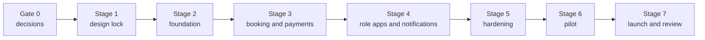

# Implementation Roadmap: PRD to Deployment

**Status:** Proposed · **Version:** 0.1 · **Date:** 2026-10-12 · **Owner:** Product Manager
**Governed by:** `CANONICAL-PROJECT-LIFECYCLE.yaml`, D-011, D-012, D-019, D-020 · **Open issues:** OI-001, OI-029, OI-030, OI-033, OI-036, OI-038, OI-040

> **Sequence updated (D-046):** after the transport sign-off and the documentation freeze, development is frontend first on frozen contracts, then backend. Where this roadmap shows backend stages first, `DEVELOPMENT-STRATEGY.md` §6 and §7 govern the order.

---

## 1. Shape of the path

No date is set. Each gate is passed by evidence, not by elapsed time.

---

## 2. Gate 0: Decisions (sponsor and reconvene)

| Item | Owner | Done when |
|---|---|---|
| Ratify or reject D-024 (stack) | Respondents at OI-001 reconvene | Log shows D-024 Accepted or a replacement |
| Decide D-002 and D-003 (technical pair) | Respondents (reconvene session B) | Both Accepted |
| Decide D-007 with AUTH-2 (policy pair) | Respondents with Security | Both Accepted |
| Answer Q-001 to Q-004 | Sponsor | QA-LOG answers recorded; decisions updated |
| Choose hosting tier (OI-030) | Sponsor | Budget decision recorded |
| Reconcile SMS channel (OI-031) | Sponsor | Decision recorded |

**Gate 0 exit:** all rows done. Engineering starts only after this (`CANONICAL-PROJECT-LIFECYCLE.yaml` design exit gate).

---

## 3. Stage 1: Design lock

| Deliverable | Owner | Artifact |
|---|---|---|
| Product scope and journeys signed off | PM, Sponsor | `PRODUCT/SCOPE-AND-JOURNEYS.md` Accepted |
| Canonical state machines validated | PM, Backend, Database | `STATE-MACHINES/STATE-MACHINES.md` Accepted (OI-027 closed) |
| Entity model reviewed; mutability list confirmed | Database, Security | `DATA-MODEL/ENTITIES.md` Accepted (OI-003 closed) |
| Contracts reviewed | Backend, Frontend | `API-CONTRACTS/CONTRACTS.md` Accepted |
| Walkthrough with transport department | PM, Liaison | Findings logged as Q- or BUG- entries |
| Drift check: documents against log | PM | Findings resolved |
| Prototype alignment with D-025 axes | Frontend, UI/UX | Prototypes updated; walkthrough repeated |
| Design system decision | Sponsor | OI-034 Decided |

**Stage 1 exit:** DATA-MODEL, STATE-MACHINES, API-CONTRACTS and PAYMENTS-DESIGN are Accepted; no open Blocking OI on them.

---

## 4. Stage 2: Foundation

| Deliverable | Owner | Evidence |
|---|---|---|
| Repository, CI (lint, typecheck, unit), local Supabase stack | DevOps, Backend | Green pipeline |
| Migrations: schema `transport`, enums, tables, transitions, audit | Database | Migrations applied to local and staging |
| RLS policies per role | Database, Security | pgTAP RLS suite green (T1 to T4, T13) |
| Auth: sign-in methods, profile creation, membership gate, approval function | Backend, Security | Journey A passes in E2E |
| Roster CSV import (reversible, batch recorded) | Backend | Import test with synthetic file |
| Programmes, routes, buses, assignments, departures | Backend | Admin functions tested |
| Seat holds, confirmation for free programmes, expiry job | Backend | pgTAP plus k6 concurrency at 2x capacity |
| Manifest functions (board, no-show, remove, walk-on) | Backend | Transition tests green |

**Stage 2 exit:** all SQL suites green in CI; concurrency test shows zero overbooking; Journey A and free-booking half of Journey B pass in E2E on staging.

---

## 5. Stage 3: Booking and payments

| Deliverable | Owner | Evidence |
|---|---|---|
| Member booking flow (legs, bus, pickup, riders, confirm) | Frontend | Journey B free path E2E |
| Guests: invite link, public registration, member onboarding | Backend, Frontend | G1 to G3 tests |
| Provider sandbox verification (OI-033 checklist) | Integrations | Checklist signed in PROVIDER-CONTRACTS |
| `start-payment`, webhooks, `apply_payment_event`, reconciliation | Integrations, Backend | Payment acceptance tests (PAYMENTS §9) green |
| Payment provider picker and return page | Frontend | No card fields anywhere (repository scan) |
| Cancellation (member, marshal, admin) | Backend | One function, three callers, convergence test |

**Stage 3 exit:** payment acceptance tests all green; checklist in PROVIDER-CONTRACTS complete; Journey B paid path passes in sandbox.

---

## 6. Stage 4: Role apps and notifications

| Deliverable | Owner | Evidence |
|---|---|---|
| Marshal duty, manifest (outbound and return), board and no-show, walk-on, incident, contact admin | Frontend | Journey D E2E; UAT-2 script passes on staging |
| Admin programmes and special events (create, publish, open, pause, close, cancel) | Frontend, Backend | Journey E and G E2E; UAT-1 script passes |
| Admin fleet (per-bus toggle), bookings, people queue, guests, roster | Frontend | E2E |
| Admin support queue and report triage (Journey H) | Frontend, Backend | E2E; audit row on every change |
| Notifications: outbox, push, email, inbox; marshal route scoping | Backend, UI/UX | Event catalogue tests (NOTIFICATIONS §8) |
| Install flow and permission ask timing | UI/UX, Frontend | Manual test on iOS home-screen install and Android |
| Printable manifest export (offline fallback) | Frontend | Output matches data; timestamp shown |

**Stage 4 exit:** UAT-1, UAT-2 and UAT-3 scripts pass on staging with synthetic data; accessibility checks green on all routes.

---

## 7. Stage 5: Hardening

| Deliverable | Owner | Evidence |
|---|---|---|
| Refund rules ratified (OI-036) and refund workflow | Sponsor (rules), Backend | Refund state tests; policy linked |
| Bus cancellation and breakdown flows (OI-019) | Backend, Frontend | Incident tests; notifications delivered in staging |
| Corrections (supersession) and audit view | Backend, Frontend | Correction tests; audit read-only check |
| Security acceptance (SECURITY §7) | Security | Checklist complete |
| Data protection review (OI-038) | Sponsor with counsel | Written outcome recorded |
| Backup restore drill (RISK-001) | DevOps | Counts match source |
| Load test at pilot size and 2x | QA | k6 report in release record |
| Runbooks written (DEVOPS §8) | DevOps | Reviewed by on-call admin |

**Stage 5 exit:** Security acceptance and restore drill passed; data protection outcome recorded.

---

## 8. Stage 6: Pilot

| Step | Detail |
|---|---|
| Scope | One special event and one Sunday service with the WhatsApp and paper fallback running (OI-040) |
| Staffing | Named marshals and admins (two admins, OI-014) |
| Daily review | Incidents, missed alerts, payment differences, support queue |
| Pilot exit criteria (proposed) | Manifest matches the paper list at departure; no unresolved payment differences; missed-alert rate below the agreed threshold; no S1 open |
| Decision | Continue, fix and repeat, or stop with a recorded reason |

---

## 9. Stage 7: Launch and review

| Step | Detail |
|---|---|
| Launch gate | Constitution Phase C gates: concurrency test pass, webhook retry test pass, UAT with real marshals, backups verified |
| Launch | Production released from a staging-tested build; paper fallback kept for the first two programmes |
| 30-day review | Support load, payment reconciliation, notification delivery, cost against OI-030 |
| Optimisation pass | Per `OPTIMISATION/OPTIMISATION-PLAN.md` §8 triggers |
| Decision log | Lessons recorded as decisions or risks |

---

## 10. Deployment plan (summary)

1. Create production Supabase project (Pro), region per OI-032. Set secrets (`DEVOPS/ENVIRONMENT-VARIABLES.md`).
2. Apply migrations from the pipeline. Verify with pgTAP against production read-only checks.
3. Create Vercel production project (Pro), custom domain, environment variables.
4. Configure provider webhook URLs to the production Edge Function endpoints, with live keys.
5. Load the membership roster by CSV import (batch recorded).
6. Create admin accounts with MFA; create a second admin (OI-014).
7. Smoke test with a test account: sign in, book, pay the minimum sandbox-equivalent live test if the provider permits it, cancel, confirm audit rows.
8. Enable scheduler jobs (hold expiry, outbox, reconciliation).
9. Confirm backups visible in the provider console and the first restore drill date set.

Rollback: promote previous frontend deployment; forward migrations only; redeploy previous Edge Functions.

---

## 11. Testing and optimisation across stages

| Stage | Testing | Optimisation |
|---|---|---|
| 2 | pgTAP, concurrency | Index review on seeded volume |
| 3 | Payment acceptance, sandbox | Latency measurement (OI-032) |
| 4 | E2E, accessibility, UAT | Performance budgets on booking and manifest |
| 5 | Load, restore, security | Cost review against plan |
| 6 | Pilot observation | Real-device Web Vitals (aggregated) |
| 7 | Regression on every release | Scale triggers reviewed |

---

## 12. Dependencies

Gate 0 blocks everything. Stage 3 payments depend on OI-033 and OI-025. Stage 5 refunds depend on OI-036. The pilot depends on OI-038 and OI-040. Stage 4 notifications depend on OI-031 and OI-037.
